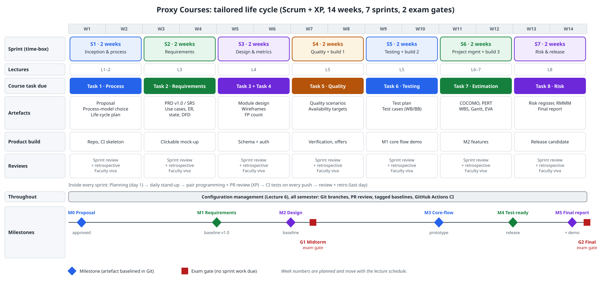

# Task 1 — Software Process (Lectures 1–2) · 10 marks

**Project:** Proxy Courses: A Peer-Tutoring and Advising Platform for IUB Students
**Course:** CSE451 / CSC445 Software Engineering, Autumn 2026, IUB · **Faculty:** Md Masum Billah

| Member | ID |
|---|---|
| Syed Mehedi Hussain | 2310690 |
| Arafat Hossain | 2420834 |
| Rukaiya Tabassum | 2420183 |
| Meharab Hossen Opi | 2420832 |

---

## 1.1 Product characterisation

### Application domain

Proxy Courses is a **two-sided education marketplace** for one campus (IUB). In Pressman's
categories it is a **web/mobile application** (a responsive web app now, native apps later) with a
**business-application** core: subscriptions, payments, refunds and monthly tutor payouts.
Four kinds of users meet in it:

- learners who need help in a course;
- tutors (seniors and alumni with a verified A or A-) who sell semester-long help for 500 taka;
- advisors (faculty and club executives) who offer free time slots;
- admins who verify transcripts and handle the money.

It works alongside, rather than replacing, YouTube (videos), Zoom and Google Meet (live classes),
and a payment gateway for bKash, Nagad and cards.

### Software versus hardware: how the traits show up here

| Trait (Lecture 1) | What it means | What it means for Proxy Courses |
|---|---|---|
| Software is **developed, not manufactured** | Cost is in engineering, not in making copies | Serving 10 learners or 10,000 costs about the same in code; our cost is the team's 14 weeks, not the copies |
| Software **does not wear out, but it deteriorates** | No physical wear; quality drops as changes pile up | Every new rule (refund window, 80/20 split, add-ons) risks side effects in payment code, so we rely on regression tests in CI |
| Most software is **custom-built**, though reuse is growing | Assembled from components where possible | We reuse Next.js, PostgreSQL, a payment gateway, YouTube and Zoom; we build only the marketplace rules |
| **Complexity and invisibility** | Hard to see the structure | 4 roles × 7 modules × money states; we make them visible with use-case, state and ER models (Task 2) |
| **Changeability** | People expect software to change | Prices, the split and the refund rule are stored as admin **settings**, not hard-coded |

### Failure causes

Hardware follows the **bathtub curve**: early failures, a long flat stretch, then wear-out.
Software in theory would only have early failures. In practice it follows the **actual failure
curve**: each change adds a spike of new defects, and the minimum failure rate creeps upward
(deterioration). The causes we expect in Proxy Courses:

1. **Requirement errors:** an unclear refund rule leads to wrong refunds (open question Q1).
2. **Side effects of change:** changing the 70/30 split breaks the payout totals.
3. **Integration failures:** the gateway calls back twice and we record a double payment, or its API changes.
4. **Environment limits:** free-tier database or email quotas run out during the demo.
5. **Human and operational errors:** an admin approves an edited transcript.

### Maintenance split

The split commonly quoted in the lecture: corrective ≈ 21%, adaptive ≈ 25%, perfective ≈ 50%,
preventive ≈ 4%. Our estimate for Proxy Courses, with the reason for each:

| Type | Typical | Proxy Courses (estimate) | Why |
|---|---|---|---|
| Corrective (fix defects) | 21% | 20% | Money paths are tested heavily before release |
| Adaptive (fit a changed environment) | 25% | 30% | The gateway API, IUB email rules, browser and hosting changes, and native apps later |
| Perfective (new or better features) | 50% | 45% | Mobile app, other universities, tutor-set prices (all on the "later" list) |
| Preventive (refactor to avoid future failures) | 4% | 5% | Keeping the service layer clean as rules grow |
| **Total** | 100% | **100%** | |

### Two software myths

| Myth | Type | Reality | How it would hurt Proxy Courses |
|---|---|---|---|
| "If we fall behind, we can add more people and catch up." | Management | Brooks's law: adding people to a late project makes it later, because new people need training and add communication paths: n(n−1)/2 grows from 6 paths (4 people) to 10 (5 people). | A late sprint is fixed by cutting Could-have items (MoSCoW), not by recruiting a fifth member mid-semester. |
| "Requirements can change any time; software is flexible." | Customer | The cost of a change grows with each phase. A late change touches code, tests, documents and data that already exist. | Changing the revenue split after payments exist means migrating stored splits and redoing payout reports, so the split is a **setting** plus a change-control process (Task 2.16). |

---

## 1.2 Process-model comparison

Three candidate models, scored from 1 (poor) to 5 (excellent) against five criteria. The weights
show what matters most for a 4-person, part-time, 14-week student project.

| # | Criterion | Weight | Waterfall | Spiral | Scrum + XP |
|---|---|---|---|---|---|
| C1 | Copes with changing requirements (pricing and refund rules will change after interviews) | 0.25 | 1 | 4 | 5 |
| C2 | Early working software and user feedback | 0.20 | 1 | 3 | 5 |
| C3 | Fits a fixed 14-week semester with a task due every 2 weeks | 0.20 | 3 | 2 | 5 |
| C4 | Produces the documents the course grades (Tasks 1–8) | 0.20 | 5 | 4 | 3 |
| C5 | Controls risk for a small team (payments, IUB permission) | 0.15 | 2 | 5 | 4 |
| | **Weighted score** | **1.00** | **2.35** | **3.55** | **4.45** |

**Working** (weighted score = Σ weight × score):

- Waterfall = 0.25·1 + 0.20·1 + 0.20·3 + 0.20·5 + 0.15·2 = 0.25 + 0.20 + 0.60 + 1.00 + 0.30 = **2.35**
- Spiral = 0.25·4 + 0.20·3 + 0.20·2 + 0.20·4 + 0.15·5 = 1.00 + 0.60 + 0.40 + 0.80 + 0.75 = **3.55**
- Scrum + XP = 0.25·5 + 0.20·5 + 0.20·5 + 0.20·3 + 0.15·4 = 1.25 + 1.00 + 1.00 + 0.60 + 0.60 = **4.45**

### Justification (≤150 words)

> We choose **Scrum with XP practices and MoSCoW priorities**. Our requirements are not stable:
> prices, the refund window and the top-tutor rule will change once we interview learners and
> tutors, which rules out Waterfall (C1 = 1). Spiral handles risk best, but its formal risk cycle
> is too heavy for four part-time students and does not match a deliverable every two weeks
> (C3 = 2). Two-week Scrum sprints line up exactly with the course tasks, and each sprint review
> shows a working piece to users. XP adds pair programming, code review and CI tests on every
> push, which protect the payment logic. Scrum's weakness is documentation (C4 = 3), so our
> Definition of Done for every sprint includes that sprint's course-task document. We borrow
> Spiral's strength by keeping a risk register from Sprint 1 (Task 8).

*(Word count: 136)*

---

## 1.3 Tailored life-cycle diagram

Files: [`diagrams/lifecycle.svg`](diagrams/lifecycle.svg) · [`diagrams/lifecycle.png`](diagrams/lifecycle.png)

**How to read it**

- **Phases and time-boxes:** seven 2-week sprints (S1–S7) across 14 weeks, plus two exam gates (midterm and final).
- **Where Tasks 2–8 happen:** each sprint delivers the course task for the lectures taught in it: Task 2 in S2, Tasks 3 and 4 in S3, Task 5 in S4, Task 6 in S5, Task 7 in S6, Task 8 in S7.
- **Artefacts:** the document produced in each sprint. It is merged into Git and tagged when baselined.
- **Milestones:** M0 proposal approved, M1 requirements baseline v1.0, M2 design baseline, M3 core-flow prototype, M4 test-ready release, M5 final report and demo.
- **Reviews:** each sprint ends with a sprint review (demo to users and the faculty), a retrospective, and the task viva.
- **Inside a sprint:** planning → daily stand-up → pair programming and pull-request review → CI tests on every push → review and retrospective.
- **Configuration management (Lecture 6)** has no task of its own, so it runs across the whole semester: Git branches, pull-request reviews, tagged baselines and GitHub Actions.

### Team roles

| Role | Member |
|---|---|
| Product owner | *to be agreed* |
| Scrum master | *to be agreed* |
| QA lead | *to be agreed* |
| Developers | All four members |
