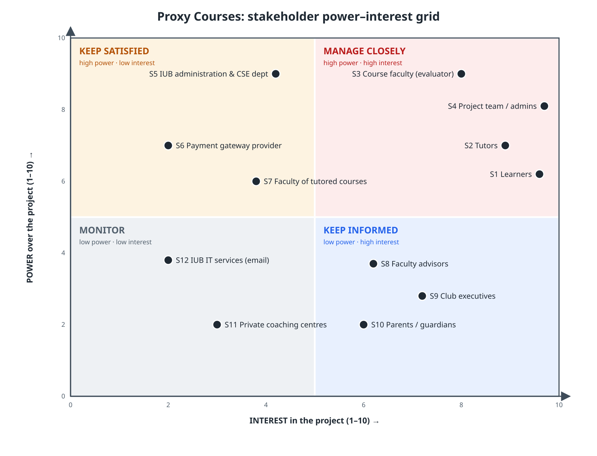
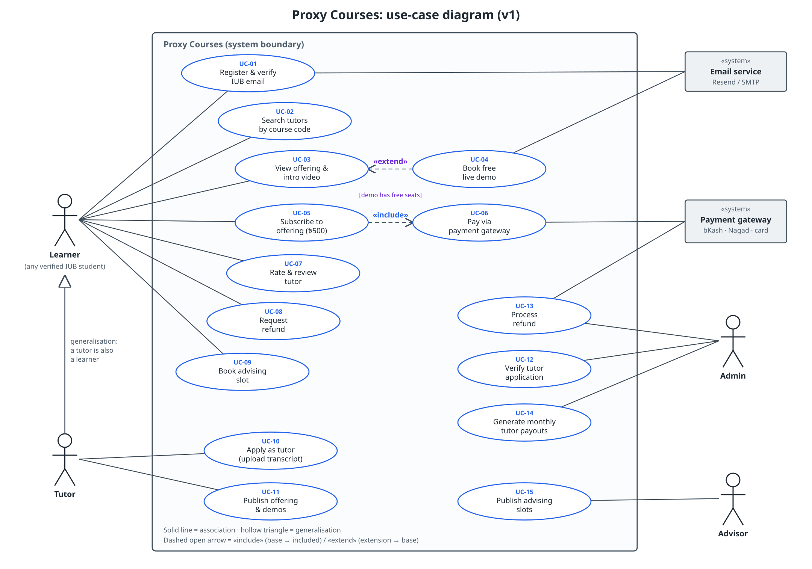
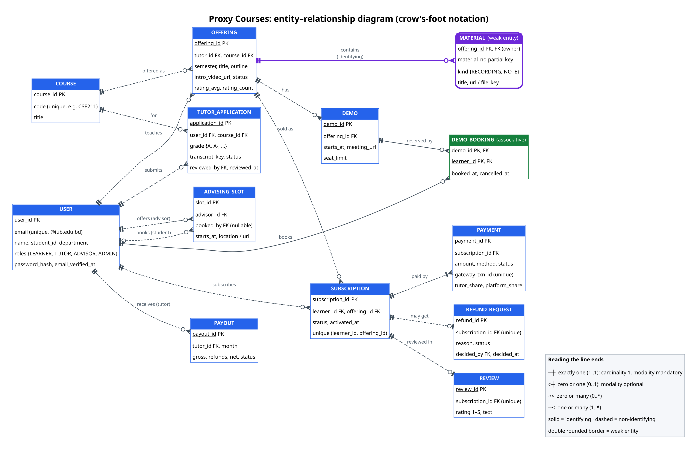
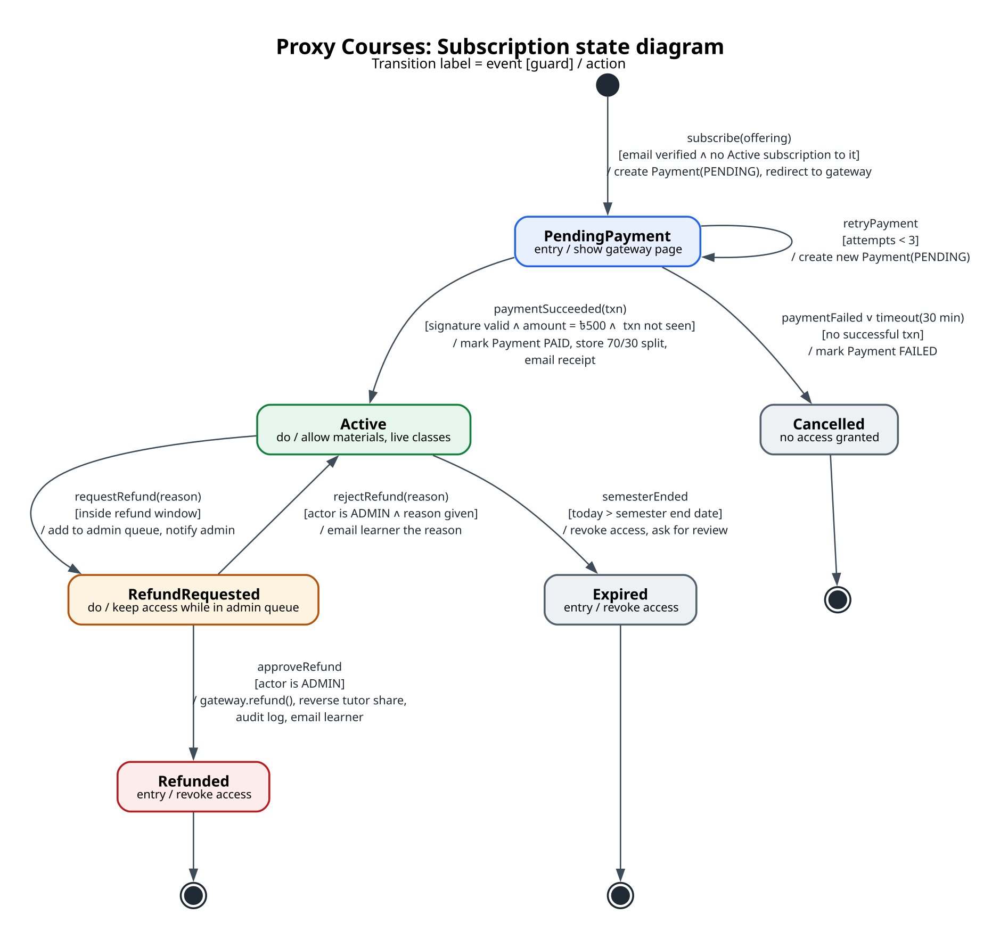
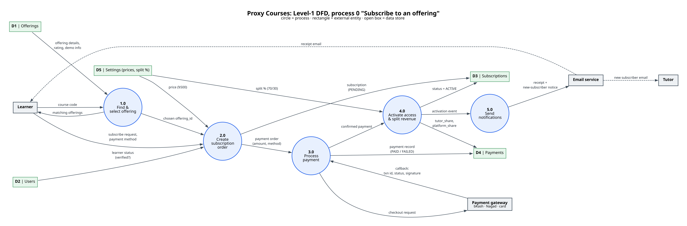
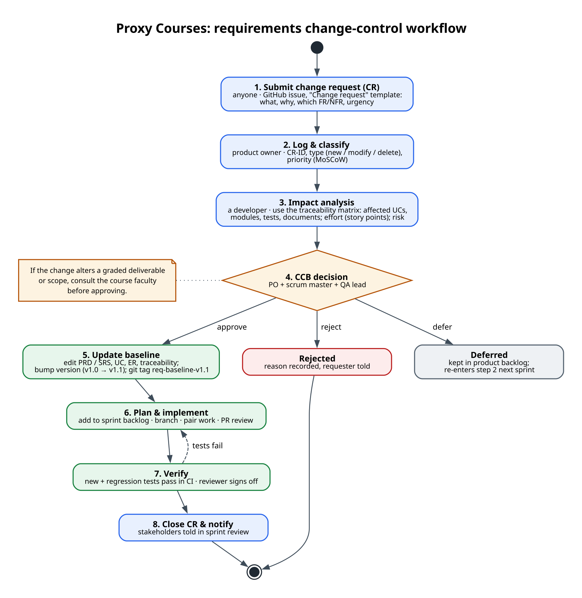

# Task 2 — Requirements Engineering (Lecture 3) · 22 marks

**Project:** Proxy Courses · **Team:** Syed Mehedi Hussain (2310690), Arafat Hossain (2420834),
Rukaiya Tabassum (2420183), Meharab Hossen Opi (2420832) · **Faculty:** Md Masum Billah

Source requirements: [PRD v0.2](../../prd.md). All diagrams are in [`diagrams/`](diagrams/) as `.svg` and `.png`,
with the editable source (`.dot` or `_tools/draw_*.py`).

Contents: 2.1 Stakeholders · 2.2 Power–interest grid · 2.3 Elicitation · 2.4 Requirements catalogue ·
2.5 User stories · 2.6 Use-case diagram · 2.7 Use-case narrative · 2.8 Analysis classes · 2.9 CRC cards ·
2.10 ER diagram · 2.11 State diagram · 2.12 Level-1 DFD · 2.13 Win-win · 2.14 Requirements review ·
2.15 Traceability · 2.16 Change control and baseline

---

## 2.1 Stakeholder table (12 groups)

Power and interest are on a 1–10 scale and are our team's judgement; they place each group on the grid in 2.2.

| ID | Stakeholder | Role / stake | Main needs | Power | Interest | Strategy |
|---|---|---|---|---|---|---|
| S1 | Learners (IUB students) | Primary users who pay | Cheap, syllabus-matched help; a free trial; refunds | 6 | 10 | Manage closely |
| S2 | Tutors (seniors, alumni with A / A-) | Supply side; earn 70–80% | Fair pay, simple publishing, on-time payouts | 7 | 9 | Manage closely |
| S3 | Course faculty (Md Masum Billah) | Evaluator and sponsor of the project | Correct SE method, on-time deliverables | 9 | 8 | Manage closely |
| S4 | Project team / platform admins | Build and run the system; verify tutors | Clear scope, workable admin tools | 8 | 10 | Manage closely |
| S5 | IUB administration and CSE department | Can allow or stop the platform | Academic integrity, reputation, no liability | 9 | 4 | Keep satisfied |
| S6 | Payment gateway provider (SSLCommerz / bKash / Nagad) | External system; holds the merchant terms | Compliant integration, valid callbacks | 7 | 2 | Keep satisfied |
| S7 | Faculty teaching the tutored courses | Their exam style is what tutors teach | No leaked exam material, no cheating | 6 | 4 | Keep satisfied |
| S8 | Faculty advisors | Offer free advising slots | Fewer repeated questions; easy scheduling | 4 | 6 | Keep informed |
| S9 | Club executives | Offer free advising | Reach juniors; visibility for the club | 3 | 7 | Keep informed |
| S10 | Parents and guardians | Often pay for learners | Value for money, safety | 2 | 6 | Keep informed |
| S11 | Private coaching centres | Competitors | Lose students to the platform | 2 | 3 | Monitor |
| S12 | IUB IT services | Run the `@iub.edu.bd` email that sign-up depends on | No abuse of the email system | 4 | 2 | Monitor |

## 2.2 Power–interest grid

The four **manage closely** groups (S1–S4) attend sprint reviews. S5 gets a short written brief before
launch (risk: permission, see PRD Q3). S6 is handled through its sandbox and terms of service.

## 2.3 Elicitation plan

| # | Technique | With whom | When | How | Output |
|---|---|---|---|---|---|
| E1 | **Semi-structured interviews** | 5 learners, 3 tutors (A / A- holders), 1 faculty advisor | Sprint 2, week 3 | 20–30 min each, in person or on Meet, two team members (one asks, one notes) | Interview notes → candidate FRs, pricing and refund opinions |
| E2 | **Questionnaire (Google Form)** | IUB students via department Facebook groups; target ≥ 50 replies | Sprint 2, weeks 3–4 | 12 closed + 3 open questions: hard courses, willingness to pay, payment method, trust signals | Numbers for price (৳500), the demand estimate and payment-method mix |
| E3 | **Observation / document analysis** | Existing "tutor wanted" posts in IUB Facebook groups and current coaching flyers | Sprint 2, week 3 | Collect 30 posts; code them by course, price, problems mentioned | Real course list for the seed data; problems like no-shows and no refunds |

The three techniques cross-check one another: interviews give depth, the survey gives numbers, and
observation shows what people actually do rather than what they say.

### Five context-free questions (asked at the start of every E1 interview)

1. Who is behind the request for a peer-tutoring platform, and who would use it?
2. What would a successful solution look like to you; how would you know it works?
3. What problem would this solve for you that you can't solve today?
4. Is there another way you get this help now, and what's wrong with it?
5. Are you the right person to answer these questions? Who else should we ask?

## 2.4 Requirements catalogue

MoSCoW: **M** must · **S** should · **C** could · **W** won't (this release). Full acceptance criteria are in the [PRD](../../prd.md).

### Functional requirements (36)

| ID | Requirement (the system shall…) | MoSCoW | Source |
|---|---|---|---|
| FR-01 | let users sign up and log in only with a verified `@iub.edu.bd` email | M | S1, S5 |
| FR-02 | let users log out and reset their password by email | M | S1 |
| FR-03 | keep a profile (name, student ID, department, photo) | M | S1, S2 |
| FR-04 | let a user apply as tutor for a course by uploading a transcript | M | S2, S4 |
| FR-05 | let an admin approve or reject a tutor application, with a reason | M | S4 |
| FR-06 | allow approval only for a grade of A or A- | M | S5, S7 |
| FR-07 | let an admin give the advisor role to faculty and club executives | M | S8, S9 |
| FR-08 | show a verified badge on tutor and advisor profiles | S | S1 |
| FR-09 | let a tutor create an offering only for an approved course | M | S2 |
| FR-10 | let a tutor add a free intro video link (YouTube unlisted) | M | S1, S2 |
| FR-11 | let a tutor add recorded class links and notes, for subscribers only | M | S2 |
| FR-12 | let a tutor schedule live group classes with a meeting link | M | S2 |
| FR-13 | let a tutor schedule free live demos with a seat limit | M | S1, S2 |
| FR-14 | fix prices by platform setting (৳500 subscription, ৳200 one-to-one) | M | S4 |
| FR-15 | let a tutor unpublish an offering without cutting off subscribers | S | S2 |
| FR-16 | search offerings by course code | M | S1 |
| FR-17 | filter and sort results by rating, price, subscribers | S | S1 |
| FR-18 | show an offering page (tutor, badge, video, outline, rating, reviews) | M | S1 |
| FR-19 | let a learner book a seat in a free demo | M | S1 |
| FR-20 | let a learner cancel a demo booking | S | S1 |
| FR-21 | let a learner subscribe to an offering for the semester | M | S1, S2 |
| FR-22 | take payment by bKash, Nagad or card through a gateway, recording each payment once | M | S1, S6 |
| FR-23 | let a subscriber buy a one-to-one add-on (৳200) | S | S1, S2 |
| FR-24 | show a learner their subscriptions and receipts | M | S1, S10 |
| FR-25 | let a subscriber request a refund within the refund window | M | S1 |
| FR-26 | let an admin approve or reject a refund | M | S4 |
| FR-27 | let only subscribers rate (1–5) and review an offering, once each | M | S1, S2 |
| FR-28 | show average rating and count on offering and tutor | M | S1 |
| FR-29 | let users report a review or a tutor | S | S4 |
| FR-30 | let an advisor publish free time slots | M | S8, S9 |
| FR-31 | let a student book and cancel an advising slot | M | S1 |
| FR-32 | give admins one queue for applications, refunds and reports | M | S4 |
| FR-33 | store a 70/30 split on each payment (80/20 for top-rated tutors) | M | S2, S4 |
| FR-34 | produce a monthly payout report per tutor, exportable as CSV | M | S2, S4 |
| FR-35 | show an admin dashboard (users, subscriptions, revenue, disputes) | C | S4 |
| FR-36 | email users on key events (approval, payment, booking, refund) | S | S1, S2 |
| — | other universities; tutor-set prices; own video hosting; IUB portal grade check; AI summaries; native apps | **W** | Proposal §4 |

### Non-functional requirements (12), each with a metric

| ID | Attribute | Requirement | Metric and target | How measured |
|---|---|---|---|---|
| NFR-01 | Performance | Pages and search respond quickly on mobile data | Page load (LCP) ≤ 2.0 s on simulated 4G; search API p95 ≤ 500 ms with 1,000 offerings | Lighthouse in CI; k6 load test |
| NFR-02 | Availability | Available during the semester | ≥ 99.0% monthly uptime (≤ 7.3 h downtime / 30 days) | Uptime monitor pinging `/api/health` every 5 min |
| NFR-03 | Usability / responsive | Usable on phones | Core flow completable at 360 px width; no horizontal scroll; 5 of 5 test users finish "find & subscribe" in ≤ 3 min | Playwright at 360 px; hallway usability test |
| NFR-04 | Security | Protect accounts and enforce roles | 0 routes reachable without the right role (automated check); passwords hashed with argon2/bcrypt; 100% HTTPS | Role-matrix API test; OWASP ZAP baseline scan |
| NFR-05 | Privacy | Transcripts private | 0 transcript files reachable by a non-owner non-admin; links expire ≤ 10 min | API test with a second user |
| NFR-06 | Payment safety | No card or wallet data held | 0 card / PIN fields stored in DB; 100% of callbacks signature-checked | Schema review; unit test with a forged signature |
| NFR-07 | Auditability | Money and verification actions are traceable | 100% of approve / refund / payout actions have an audit row (actor, time) | DB query in test |
| NFR-08 | Accessibility | Core flow accessible | WCAG 2.1 AA: 0 serious axe-core violations; contrast ≥ 4.5:1 | axe-core in Playwright |
| NFR-09 | Cost | Runs on free tiers during the semester | ≤ ৳0 per month hosting until launch | Monthly bill check |
| NFR-10 | Maintainability | Code stays changeable | ≥ 70% line coverage on services; 0 lint or type errors; 100% of PRs reviewed | CI report; GitHub branch rules |
| NFR-11 | Testability | Core flow tested automatically | 100% of "Proto" FRs covered by at least one automated test | Traceability matrix (2.15) |
| NFR-12 | Portability | A mobile app can reuse the backend | 100% of business actions available as `/api` JSON routes | API route list vs FR list |

## 2.5 User stories with INVEST check

| ID | Story | FR |
|---|---|---|
| US-1 | As a **learner**, I want to search tutors by course code so that I find help for the exact IUB course I'm taking. | FR-16 |
| US-2 | As a **learner**, I want to book a seat in a tutor's free live demo so that I can judge the teaching before paying. | FR-19 |
| US-3 | As a **learner**, I want to subscribe to an offering and pay with bKash so that I get the semester's classes and notes. | FR-21, 22 |
| US-4 | As a **senior student**, I want to apply as a tutor by uploading my transcript so that I can earn by teaching a course I aced. | FR-04 |
| US-5 | As an **admin**, I want to approve or reject tutor applications with a reason so that only real A / A- students can sell help. | FR-05, 06 |
| US-6 | As a **student**, I want to book a free advising slot with a faculty member so that I get course-planning advice without queuing. | FR-31 |

**INVEST check** (✓ meets · ✗ fails → fixed)

| Story | I | N | V | E | S | T | Notes |
|---|---|---|---|---|---|---|---|
| US-1 | ✓ | ✓ | ✓ | ✓ | ✓ | ✓ | Testable: a known code returns known results |
| US-2 | ✓ | ✓ | ✓ | ✓ | ✓ | ✓ | Depends on demos existing → seed data keeps it independent for testing |
| US-3 | ✓ | ✓ | ✓ | ✓ | **✗ → ✓** | ✓ | Too big at first (subscription + real gateway). **Split:** US-3a subscribe with the mock gateway (Sprint 4); US-3b SSLCommerz sandbox (later) |
| US-4 | ✓ | ✓ | ✓ | ✓ | ✓ | ✓ | File limits make it testable |
| US-5 | ✗ → ✓ | ✓ | ✓ | ✓ | ✓ | ✓ | Depended on US-4 for data; made independent by seeding pending applications |
| US-6 | ✓ | ✓ | ✓ | ✓ | ✓ | ✓ | |

**Acceptance criteria** (Given / When / Then)

- **US-1:** Given published offerings for CSE211 and CSE213, when I search `cse211`, then I see only CSE211 offerings, each with tutor name, verified badge, rating and price; and when I search `XYZ999`, I see "No tutors yet for XYZ999".
- **US-2:** Given a demo with 10 seats and 9 booked, when I book, then I get the meeting link on screen and by email. Given 10 of 10 booked, when another learner books, then they see "Demo full" and no booking is stored.
- **US-3a:** Given I'm verified and not subscribed, when I choose bKash and the gateway reports success, then my subscription is Active, my receipt shows ৳500, and the materials unlock. When the gateway reports failure, I have no access and can retry. A repeated success callback creates no second payment.
- **US-4:** Given I'm logged in, when I upload a PDF ≤ 5 MB for CSE211 with grade A, then my application shows "Pending". A 6 MB file or a `.exe` is refused with a message.
- **US-5:** Given a pending application with grade B+, when I try to approve, then the system refuses. Given grade A-, when I approve, then the tutor can create a CSE211 offering and an audit row is written. When I reject, a reason is required and shown to the applicant.
- **US-6:** Given an advisor slot that's free, when I book it, then it shows as mine and both of us get an email. When a second student tries the same slot, they see "Slot taken".

## 2.6 Use-case diagram

- **Actors:** Learner, Tutor (a specialised learner, shown by generalisation), Admin and Advisor.
- **External systems:** Payment gateway and Email service. YouTube, Zoom and Meet are only stored as links, so they are not actors.
- **«include»:** UC-05 *Subscribe* always includes UC-06 *Pay via payment gateway*.
- **«extend»:** UC-04 *Book free live demo* extends UC-03 *View offering* when the demo has free seats.

| UC | Name | Primary actor | FRs |
|---|---|---|---|
| UC-01 | Register & verify IUB email | Learner | 01–03 |
| UC-02 | Search tutors by course code | Learner | 16–17 |
| UC-03 | View offering & intro video | Learner | 10, 18, 28 |
| UC-04 | Book free live demo | Learner | 19–20 |
| UC-05 | Subscribe to offering | Learner | 21, 24 |
| UC-06 | Pay via payment gateway | Learner, Payment gateway | 22, 33 |
| UC-07 | Rate & review tutor | Learner | 27–29 |
| UC-08 | Request refund | Learner | 25 |
| UC-09 | Book advising slot | Learner | 31 |
| UC-10 | Apply as tutor (upload transcript) | Tutor | 04 |
| UC-11 | Publish offering & demos | Tutor | 09–15 |
| UC-12 | Verify tutor application | Admin | 05–08, 32 |
| UC-13 | Process refund | Admin, Payment gateway | 26, 32 |
| UC-14 | Generate monthly tutor payouts | Admin | 33–35 |
| UC-15 | Publish advising slots | Advisor | 30 |

## 2.7 Fully dressed use case: UC-05 Subscribe to offering

| Field | Content |
|---|---|
| **Use case** | UC-05 Subscribe to offering |
| **Scope / level** | Proxy Courses web app / user goal |
| **Primary actor** | Learner |
| **Secondary actors** | Payment gateway (via UC-06), Email service |
| **Stakeholders & interests** | *Learner:* pay once, get access right away, a refund if it goes wrong. *Tutor:* gets the 70% share, recorded correctly. *Platform:* no double charges, a clear audit trail. *Gateway:* valid, signed requests. |
| **Preconditions** | Learner is logged in with a verified IUB email; the offering is Published; the learner has no Active subscription to it. |
| **Trigger** | Learner taps **Subscribe – ৳500** on the offering page. |
| **Success guarantee** | Subscription is Active; one Payment is PAID with tutor_share = ৳350 and platform_share = ৳150; materials unlock; a receipt email is sent; an audit row exists. |
| **Minimal guarantee** | No access is granted without a confirmed payment; no payment is recorded twice. |

**Main success scenario**

1. Learner taps **Subscribe – ৳500** on the offering page.
2. System shows a checkout summary: course, tutor, semester, price ৳500, refund rule, and payment method choices (bKash, Nagad, card).
3. Learner picks bKash and confirms.
4. System creates the Subscription (PendingPayment) and a Payment (PENDING) with the price from Settings.
5. **Include UC-06:** system redirects the learner to the payment gateway; learner pays there.
6. Gateway calls back with a transaction ID, status = success and a signature.
7. System checks the signature, the amount and that the transaction ID is new.
8. System marks the Payment PAID, stores the 70/30 split and sets the Subscription to Active.
9. System shows "You're in!" with links to materials and the next live class.
10. System emails the receipt to the learner and a new-subscriber notice to the tutor.

**Extensions**

- **2a.** The learner already has an Active subscription: the system shows "Already subscribed" and a link to the materials. Ends.
- **3a.** The learner cancels at checkout: no records are created. Ends.
- **6a.** The gateway reports failure or the learner abandons it: the Payment becomes FAILED and the Subscription Cancelled after 30 min. The system offers **Try again** (up to 3 attempts).
- **7a.** The signature is invalid or the amount doesn't match: the callback is rejected and logged as a security event, and the admin is alerted. No access is given.
- **7b.** The transaction ID was already processed (duplicate callback): the system returns OK to the gateway and changes nothing.
- **10a.** The email service is down: the email is queued and retried. Subscription access is not affected.

| Field | Content |
|---|---|
| **Special requirements** | NFR-01 (checkout ≤ 2 s), NFR-04 (HTTPS, role check), NFR-06 (no card data stored), NFR-07 (audit row) |
| **Technology / data variations** | Payment method: bKash, Nagad or card (all through the gateway); the mock gateway in development and tests |
| **Frequency** | Peak at the start of a semester; estimated 100–300 per semester (estimate, Task 7) |
| **Open issues** | Refund window length (PRD Q1); should a failed payment hold a demo seat? |

## 2.8 Analysis classes (Boundary / Control / Entity)

| Type | Class | Responsibility | Used in |
|---|---|---|---|
| Boundary | `SignUpPage` | Collect email and password; show verification state | UC-01 |
| Boundary | `SearchPage` | Take a course code; list results | UC-02 |
| Boundary | `OfferingPage` | Show offering, video, reviews; Subscribe and Book demo buttons | UC-03, 04 |
| Boundary | `CheckoutPage` | Show summary and payment method; hand over to the gateway | UC-05 |
| Boundary | `TutorApplicationForm` | Course, grade and transcript upload | UC-10 |
| Boundary | `AdminQueueView` | List and act on applications, refunds and reports | UC-12, 13 |
| Boundary | `PaymentGatewayInterface` | Talks to the external gateway (checkout, callback, refund) | UC-06, 13 |
| Boundary | `EmailInterface` | Talks to the email service | UC-01, 04, 05 |
| Control | `AuthController` | Sign-up, IUB domain rule, sessions | UC-01 |
| Control | `SearchController` | Match course code, sort, paginate | UC-02 |
| Control | `BookingController` | Seat limits for demos; one student per advising slot | UC-04, 09 |
| Control | `SubscriptionController` | Run the subscribe flow and state changes | UC-05, 08 |
| Control | `PaymentController` | Verify callbacks, idempotency, split | UC-06 |
| Control | `VerificationController` | Grade rule, approve or reject | UC-12 |
| Control | `RefundController` | Refund window, approve or reject, reverse share | UC-08, 13 |
| Control | `PayoutController` | Monthly totals per tutor | UC-14 |
| Entity | `User`, `Course`, `TutorApplication`, `Offering`, `Material`, `Demo`, `DemoBooking`, `Subscription`, `Payment`, `RefundRequest`, `Review`, `AdvisingSlot`, `Payout`, `Setting` | Persistent data (see ER in 2.10) | all |

## 2.9 CRC cards

**Class: `Subscription`** (entity)

| Responsibilities | Collaborators |
|---|---|
| Know its learner, offering and status | `User`, `Offering` |
| Move only through allowed states (2.11) | `SubscriptionController` |
| Say whether the learner may see materials now | `Material`, `OfferingPage` |
| Know whether a refund can be requested (inside the window) | `RefundRequest`, `Setting` |
| Know the payments made for it | `Payment` |

**Class: `TutorApplication`** (entity)

| Responsibilities | Collaborators |
|---|---|
| Know the applicant, course, claimed grade and transcript file | `User`, `Course`, Storage |
| Accept approval only for A or A- | `VerificationController` |
| Record who decided, when and why | `User` (admin), `AuditLog` |
| Unlock offering creation for that tutor and course when approved | `Offering` |
| Tell the applicant the result | `EmailInterface` |

## 2.10 ER diagram

- **Primary keys** are underlined. Each relationship shows **cardinality** (the outer mark: one or many) and **modality** (the inner mark: bar = mandatory, circle = optional).
- **Weak entity:** `MATERIAL` has no key of its own. It is identified by its owner `OFFERING` plus the partial key `material_no`, and the identifying relationship is drawn solid.
- **Associative entity:** `DEMO_BOOKING` resolves the many-to-many relationship between `USER` and `DEMO`. Its key is (demo_id, learner_id), so a learner cannot book the same demo twice.
- **Business rules in the model:** `REVIEW` and `REFUND_REQUEST` hang off `SUBSCRIPTION` (0..1 each), so only subscribers can review and each subscription can have at most one refund. A `SUBSCRIPTION` has 1..* `PAYMENT`s because a failed attempt can be retried.

## 2.11 State diagram: Subscription

There are 6 states (PendingPayment, Active, Cancelled, RefundRequested, Refunded, Expired), plus the initial and final pseudo-states.
Every transition is labelled **event [guard] / action**:

| From → To | Event | Guard | Action |
|---|---|---|---|
| ● → PendingPayment | subscribe(offering) | email verified ∧ no Active subscription | create Payment(PENDING), redirect to gateway |
| PendingPayment → PendingPayment | retryPayment | attempts < 3 | create new Payment(PENDING) |
| PendingPayment → Active | paymentSucceeded(txn) | signature valid ∧ amount = ৳500 ∧ txn new | mark PAID, store split, email receipt |
| PendingPayment → Cancelled | paymentFailed ∨ timeout(30 min) | no successful txn | mark Payment FAILED |
| Active → RefundRequested | requestRefund(reason) | inside refund window | add to admin queue, notify admin |
| RefundRequested → Refunded | approveRefund | actor is ADMIN | gateway.refund(), reverse tutor share, audit, email |
| RefundRequested → Active | rejectRefund(reason) | actor is ADMIN ∧ reason given | email the reason |
| Active → Expired | semesterEnded | today > semester end | revoke access, ask for a review |

## 2.12 Level-1 DFD: process 0 "Subscribe to an offering"

At context level, process 0 *Subscribe to an offering* exchanges data with the Learner, the Payment
gateway, the Email service and the Tutor. Level 1 splits it into five processes: 1.0 Find & select
offering, 2.0 Create subscription order, 3.0 Process payment, 4.0 Activate access & split revenue,
5.0 Send notifications. It also shows five data stores: D1 Offerings, D2 Users, D3 Subscriptions,
D4 Payments, D5 Settings. The flows into and out of the context-level process are kept (balancing).

## 2.13 Win-win negotiation record

**Conflict 1: refund freedom vs tutor income**

| | |
|---|---|
| Stakeholders | S1 Learners vs S2 Tutors |
| Win conditions | *Learners:* "Full refund any time if the tutor is bad." *Tutors:* "Once I've taught weeks of classes, I shouldn't lose the money." |
| Conflict | FR-25 with no limit makes tutor income unpredictable; no refunds makes learners distrust the platform. |
| Options considered | (a) No refunds · (b) Refund any time · (c) Refund inside a window · (d) Pro-rata refund |
| Agreed win-win | **(c), proposed:** full refund if requested within **14 days of subscribing and before the 3rd live class**; after that, only through an admin dispute when the tutor misses 2+ scheduled classes. The free intro video and demo lower the need for refunds. |
| Resulting change | FR-25 now names the window; a new rule enters the refund-dispute path in FR-32. **Status:** proposed, to be confirmed with the interview data (PRD Q1). |

**Conflict 2: transparency vs transcript privacy**

| | |
|---|---|
| Stakeholders | S1 Learners vs S2 Tutors (and S5 IUB on student data) |
| Win conditions | *Learners:* "Show me the tutor's real transcript so I can trust them." *Tutors:* "My full transcript is private; I don't want every grade public." |
| Conflict | Showing transcripts breaks NFR-05; showing nothing breaks trust (problem statement). |
| Options considered | (a) Public transcript · (b) Grade only · (c) Admin-verified badge only |
| Agreed win-win | **(c)+(b):** admins see the transcript; the public sees only "✓ Verified A in CSE211" plus ratings, and a report button (FR-29) for doubts. |
| Resulting change | FR-08 badge wording fixed; NFR-05 keeps transcripts admin-only with expiring links. |

## 2.14 Requirements review checklist

Eight questions applied to three requirements (✓ yes · ✗ no, with the fix):

| # | Question | FR-16 Search by code | FR-25 Request refund | NFR-01 Performance |
|---|---|---|---|---|
| Q1 | Is it **unambiguous** (one meaning only)? | ✗ "search" unclear: exact or partial? → *partial, case-insensitive match* | ✗ "refund window" undefined → *14 days and before the 3rd live class (2.13)* | ✗ "fast" → *LCP ≤ 2 s on 4G; p95 ≤ 500 ms* |
| Q2 | Is it **testable** with a clear pass / fail? | ✓ TC-06 | ✓ after Q1 fix: TC-12 | ✓ after fix: TC-16 |
| Q3 | Is it **necessary** (traces to a stakeholder need)? | ✓ S1 | ✓ S1 (trust) | ✓ S1 on mobile data |
| Q4 | Is it **consistent** with other requirements? | ✓ | ✗ clashed with tutor income → *resolved by win-win 2.13* | ✓ |
| Q5 | Is it **feasible** within time, budget and tech? | ✓ | ✓ gateway supports refunds | ✓ on free tier at 1,000 offerings; ✗ at 100k (out of scope) |
| Q6 | Is it **complete** (inputs, outputs, errors)? | ✗ no "no results" case → *added in US-1* | ✗ who decides? → *admin, FR-26* | ✓ |
| Q7 | Is it **free of design** (says what, not how)? | ✓ | ✓ | ✓ |
| Q8 | Is it **prioritised and has a source** stated? | ✓ M, S1 | ✓ M, S1 | ✓ S, S1 |

## 2.15 Traceability matrix

Requirement → use case → design module (Task 3) → test case. Test IDs are expanded in Task 6.

| Requirement | Use case | Design module | Test case |
|---|---|---|---|
| FR-01 IUB sign-up | UC-01 | M1 Accounts & Auth | TC-01 non-IUB email refused · TC-02 verification link activates |
| FR-04 Apply as tutor | UC-10 | M2 Verification, M12 Storage | TC-03 file > 5 MB refused |
| FR-05/06 Approve A / A- only | UC-12 | M2 Verification | TC-04 B+ cannot be approved |
| FR-09 Offering only for approved course | UC-11 | M3 Offerings & Content | TC-05 unapproved course → 403 |
| FR-16 Search by code | UC-02 | M4 Discovery | TC-06 `cse211` returns CSE211 only |
| FR-18 Offering page | UC-03 | M3 Offerings & Content | TC-06b page shows badge, video, rating |
| FR-19 Book demo | UC-04 | M5 Booking | TC-07 full demo refuses booking |
| FR-21 Subscribe | UC-05 | M6 Subscriptions | TC-08 failed payment → no access |
| FR-22 Pay once | UC-06 | M7 Payments | TC-09 duplicate callback → one payment |
| FR-33 Revenue split | UC-06 | M7 Payments | TC-10 ৳500 → ৳350 / ৳150 |
| FR-27 Subscribers review | UC-07 | M8 Reviews & Reports | TC-11 non-subscriber cannot review |
| FR-25 Refund window | UC-08 | M6 Subscriptions | TC-12 request after window refused |
| FR-26 Process refund | UC-13 | M9 Admin & Payouts, M7 | TC-13 approved refund revokes access |
| FR-30/31 Advising | UC-15, UC-09 | M5 Booking | TC-14 slot cannot be double-booked |
| FR-34 Payouts | UC-14 | M9 Admin & Payouts | TC-15 payout = Σ tutor share − refunds |
| FR-36 Emails | UC-01, 04, 05 | M10 Notifications | TC-02, TC-07 (email captured) |
| NFR-01 Performance | UC-02 | M4 Discovery | TC-16 p95 ≤ 500 ms at 1,000 offerings |
| NFR-03 Responsive | all UI | UI layer | TC-17 core flow at 360 px |
| NFR-05 Privacy | UC-10, UC-12 | M2, M12 Storage | TC-18 other user cannot open transcript |
| NFR-07 Audit | UC-12, 13, 14 | M11 Audit (cross-cutting) | TC-19 every approval has an audit row |
| NFR-08 Accessibility | all UI | UI layer | TC-20 axe-core: 0 serious issues |

## 2.16 Change control and baseline

**Baseline definition.** The **requirements baseline v1.0** is the reviewed and agreed set of:

- PRD (FR-01–36, NFR-01–12);
- this Task 2 document (use cases, ER, state diagram, DFD, traceability).

It is approved at the **Sprint 2 review** (milestone M1 in Task 1), and frozen in Git as tag
`req-baseline-v1.0` on `main`. From then on the baseline changes only through the workflow above:

- every change gets a CR-ID;
- the Change Control Board (product owner, scrum master, QA lead) decides;
- an approved change raises the version (v1.1, v1.2 …) with a new tag.

Changes that touch a graded deliverable or the project scope are checked with the course faculty
first. Typo and formatting fixes don't need a CR.

---

### Optional analysis models (not required by the template)

Activity / swimlane, sequence and class diagrams: waiting on Masum sir to confirm whether the section wants them.
