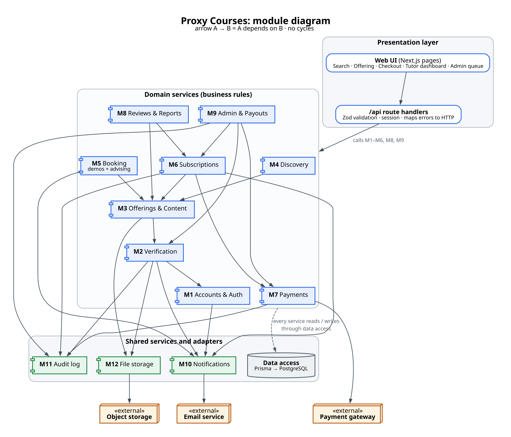
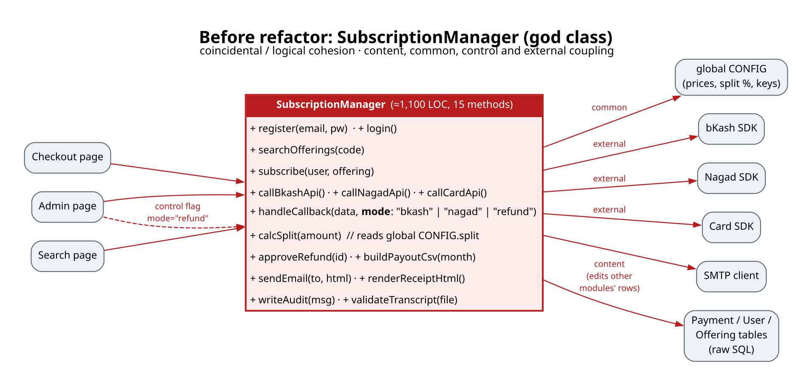
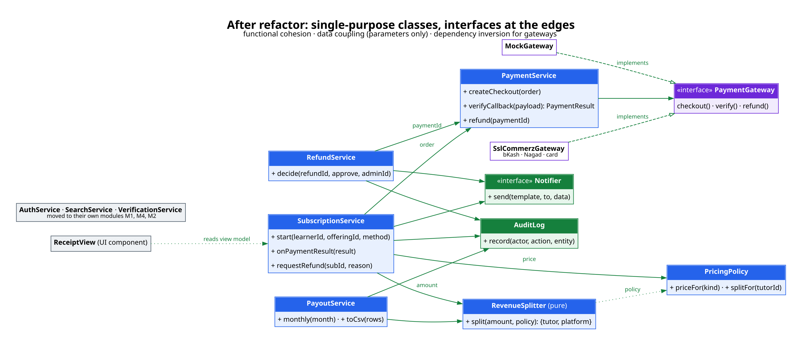
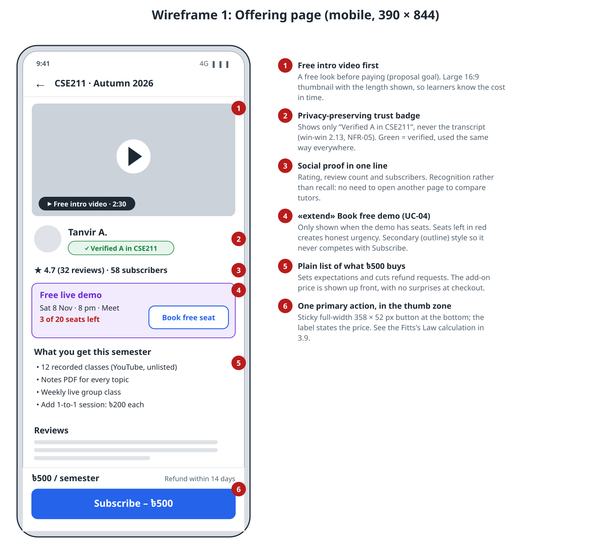
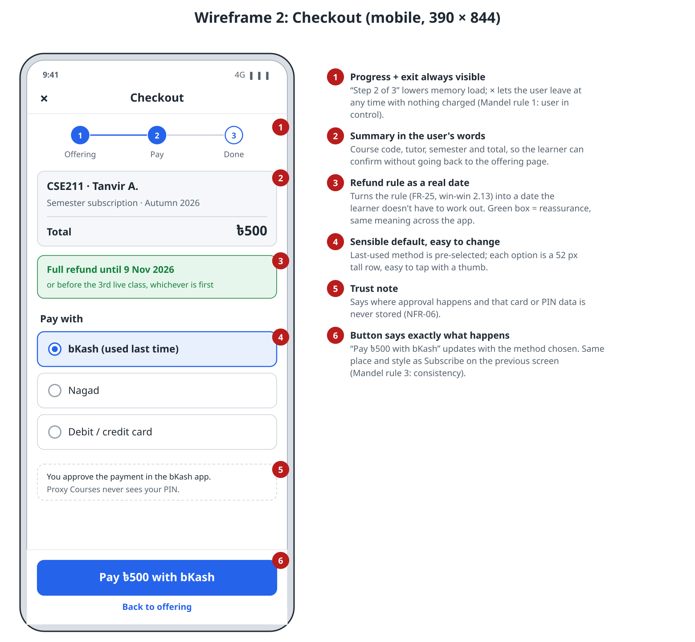
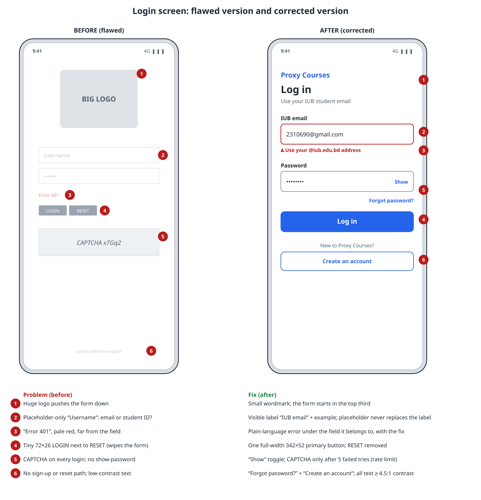

# Task 3 — Software Design (Lecture 4) · 16 marks

**Project:** Proxy Courses · **Team:** Syed Mehedi Hussain (2310690), Arafat Hossain (2420834),
Rukaiya Tabassum (2420183), Meharab Hossen Opi (2420832) · **Faculty:** Md Masum Billah

Builds on [Task 2](../2.%20Requirements/task-2-requirements.md) (use cases, analysis classes, traceability)
and the project [architecture](../../architecture.md). Diagrams: [`diagrams/`](diagrams/) (`.svg` + `.png` + source).

Contents: 3.1 Module table · 3.2 Module diagram · 3.3 God-class diagnosis · 3.4 Before/after structure ·
3.5 Cross-cutting concerns · 3.6 Golden rules, personas, task analysis · 3.7 Wireframes ·
3.8 Corrected login screen · 3.9 Fitts's Law

---

## 3.1 Module table (12 modules)

Architecture style: a **layered** web app (presentation → domain services → shared services and adapters).
Business rules live only in the domain layer, so the same rules serve the web UI now and a mobile app later.

| ID | Module | Responsibility | Interface (public operations) | Information hidden | Depends on |
|---|---|---|---|---|---|
| M1 | Accounts & Auth | Sign-up with IUB email, sessions, roles | `signUp(email, pw)`, `verifyEmail(token)`, `logIn()`, `logOut()`, `currentUser()`, `requireRole(role)` | Password hashing algorithm, session token format, domain-check rule | M10 |
| M2 | Verification | Tutor applications and the A / A- rule; advisor role | `apply(userId, courseId, grade, file)`, `decide(appId, approve, reason, adminId)`, `isApprovedTutor(userId, courseId)` | Allowed-grade list, transcript file location, review workflow | M1, M10, M11, M12 |
| M3 | Offerings & Content | Offerings, materials, live classes, demos | `createOffering()`, `publish()`, `addMaterial()`, `scheduleDemo()`, `getOffering(id, viewer)` | Which fields subscribers vs others can see; YouTube URL checks | M2, M12 |
| M4 | Discovery | Search and sort by course code | `search(code, sort, page)` | Query building, indexes, ranking formula | M3 |
| M5 | Booking | Demo seats and advising slots | `bookDemo()`, `cancelDemo()`, `publishSlots()`, `bookSlot()` | Seat-locking logic (transaction) that prevents overbooking | M3, M10 |
| M6 | Subscriptions | Subscribe flow, state machine (Task 2.11), refund requests, access checks | `start(learnerId, offeringId, method)`, `onPaymentResult(r)`, `requestRefund()`, `canAccess(userId, offeringId)` | State-transition table, refund-window rule | M3, M7, M10, M11 |
| M7 | Payments | Checkout, callback verification, refunds, revenue split | `createCheckout(order)`, `verifyCallback(payload)`, `refund(paymentId)` | Which gateway is used, signature method, idempotency keys, split calculation | M11, external gateway |
| M8 | Reviews & Reports | Ratings, reviews, reports | `upsertReview()`, `report()`, `ratingSummary(offeringId)` | Average-rating update method | M3, M6 |
| M9 | Admin & Payouts | Admin queue, refund decisions, monthly payouts, dashboard | `queue()`, `decideRefund()`, `monthlyPayouts(month)`, `exportCsv()` | Payout formula, CSV layout | M2, M6, M7, M11 |
| M10 | Notifications | Send templated emails | `send(template, to, data)` | Email provider, templates, retries | external email |
| M11 | Audit log | Record who did what (cross-cutting) | `record(actor, action, entity, data)` | Storage format of audit rows | Data access |
| M12 | File storage | Store and serve private files | `put(file)`, `signedUrl(key, ttl)` | Local folder vs S3 bucket; URL signing | external storage |

**Design checks**

- **No cycles.** M6 calls M7 to start a payment; the payment callback route calls `M6.onPaymentResult`, which asks M7 to verify. M7 never calls M6.
- **Information hiding:** for example, only M7 knows which gateway is in use (ADR-0002), so changing from the mock gateway to SSLCommerz touches one module.
- **Traceability:** module IDs match the Task 2 traceability matrix (2.15).

## 3.2 Module / component diagram



Directed arrows show "depends on". The presentation layer (pages and `/api` routes) only calls domain
services; every service reaches the database through the data-access layer (Prisma), and every outside
system sits behind its own adapter (M7, M10, M12).

## 3.3 Cohesion and coupling: diagnosing a god class

During the Sprint 2 spike, the first draft put the whole money flow into one class, `SubscriptionManager`
(design sketch, about 1,100 lines and 15 methods; see "before" in 3.4).

**Cohesion diagnosis**

| Methods found together | What they do | Cohesion type |
|---|---|---|
| `register`, `login`, `searchOfferings`, `validateTranscript` | Accounts, search and verification: no link to subscriptions | **Coincidental** (worst): grouped only because they were written in the same week |
| `callBkashApi`, `callNagadApi`, `callCardApi`, `handleCallback(mode)` | "All payment things", chosen by a `mode` flag | **Logical:** similar category, but each call runs a different branch |
| `subscribe` → `calcSplit` → `sendEmail` → `writeAudit` | Steps that happen in order | **Temporal / procedural:** tied by time, not by one purpose |

**Coupling diagnosis**

| Coupling found | Where | Why it hurts |
|---|---|---|
| **Content** (worst) | Writes directly into `Payment`, `User` and `Offering` rows with raw SQL owned by other modules | Any schema change breaks this class |
| **Common** | Reads a global `CONFIG` object for prices, split % and API keys | Changing the split for one test changes it everywhere |
| **Control** | `handleCallback(data, mode)`: the admin page passes `mode = "refund"` to steer the logic | Callers must know the class's internals |
| **External** | Calls the bKash, Nagad and card SDKs and the SMTP client directly | No way to test without network access; changing gateway means rewriting the class |

**Symptoms (simple metrics):** 15 public methods, 9 collaborators (fan-out), and low LCOM-style
cohesion: most methods share no fields with each other. Task 4 will compute the OO metrics properly.

**Refactor (applied in the design):**

- **Extract class:** `AuthService` (M1), `SearchService` (M4) and `VerificationService` (M2) move to their own modules.
- **Replace the control flag with polymorphism:** a `PaymentGateway` interface with `MockGateway` and `SslCommerzGateway`.
- **Pure function:** `RevenueSplitter.split(amount, policy)` for the split.
- **Policy object:** `PricingPolicy` replaces the global `CONFIG`.
- **Services:** `RefundService` and `PayoutService` take the refund and payout work.
- **Injected interfaces:** `Notifier` and `AuditLog` are passed in.
- **UI split:** `ReceiptView` moves to the UI layer.

**Result:**

- **Functional cohesion:** each class does one job.
- **Data coupling:** classes pass only the IDs and values they need.
- **Dependency inversion at the edges:** services depend on interfaces, not on gateway or email code.

## 3.4 Before and after structure diagrams

**Before:** one god class with content, common, control and external coupling.



**After:** single-purpose classes with interfaces at the edges.



## 3.5 Cross-cutting concerns

| Concern | Why it cuts across | How the design handles it |
|---|---|---|
| **Authorisation (roles)** | Almost every use case checks "is this a learner / tutor / admin / owner?" | `requireRole()` in M1 is called at the start of every service operation; route wrappers `withRole('ADMIN')` add a second check. Tested by one role-matrix test (NFR-04) |
| **Audit logging** | Approvals, refunds and payouts in M2, M6, M7 and M9 must all be traceable (NFR-07) | An `audited(action)` wrapper around those service functions writes to M11, so no module writes audit rows by hand |
| **Input validation** | Every `/api` route receives untrusted input | A Zod schema per route at the API boundary; services receive typed, valid data only |
| **Error handling** | The same failures (not found, forbidden, conflict) arise everywhere | Services throw typed `DomainError`s; one mapper in the API layer turns them into 404 / 403 / 409 with `{error:{code,message}}` |

## 3.6 Mandel's golden rules, personas and task analysis

### Golden rules applied

| Rule | How Proxy Courses applies it |
|---|---|
| **1. Place the user in control** | Checkout has ✕ on every step and nothing is charged until the gateway confirms. Demo bookings can be cancelled. A refund request asks for confirmation and can be withdrawn while pending. No forced modal pop-ups. |
| **2. Reduce the user's memory load** | Search results show course code, tutor, badge, rating and price together (recognition, not recall). Checkout shows "Step 2 of 3". The refund rule is shown as an actual date ("until 9 Nov 2026"). The last-used payment method is pre-selected. Course-code search autocompletes. |
| **3. Make the interface consistent** | One primary action per screen, always a full-width blue button at the bottom. The same status chips everywhere (green = verified or active, amber = pending, red = refunded or failed). The same words throughout ("offering", "subscribe", "demo"). The admin queue uses one card layout for applications, refunds and reports. |

### Personas

| | **Nusrat:** the learner | **Tanvir:** the tutor | **Dr. Farhana Rahman:** the advisor |
|---|---|---|---|
| Who | 20, 2nd-year CSE student, struggling in CSE211 | 23, final-year, got an A in CSE211 and CSE213 | Faculty member, advises about 40 students each semester |
| Device and context | Android phone on mobile data, studies late evening, pays with bKash | Laptop for recording, phone for messages | Office desktop, short gaps between classes |
| Goals | Pass CSE211 with B+ or above; spend ≤ ৳1,000 this semester | Earn about ৳10,000 a semester without hurting their own grades | Stop answering the same advising questions by email |
| Frustrations | Coaching centres are expensive and off-syllabus; Facebook tutors vanish after payment | Students don't trust a stranger; collecting payments is awkward | Students turn up unannounced; scheduling is done by email ping-pong |
| What the design does for them | Free intro video and demo before paying; refund date shown; bKash pre-selected | Simple offering form; verified badge creates trust; automatic split and monthly payout | Publish weekly slots once; one student per slot; email confirmations |

*(Personas are composites for design. They will be checked against the interview data from Task 2.3.)*

### Task analysis: "Subscribe to help for a course" (Nusrat, hierarchical task analysis)

```
0  Get semester help for CSE211
   1  Find a tutor
      1.1  Open Proxy Courses (already logged in)
      1.2  Type "cse211" in search
      1.3  Compare results: badge, rating, subscribers, price
   2  Judge the tutor
      2.1  Watch the free intro video
      2.2  Read 2–3 reviews
      2.3  (optional) Book the free live demo → attend it
   3  Pay
      3.1  Tap "Subscribe – ৳500"
      3.2  Check summary and refund date
      3.3  Keep bKash selected → "Pay ৳500 with bKash"
      3.4  Approve in the bKash app (OTP + PIN)
   4  Start learning
      4.1  See "You're in!" confirmation
      4.2  Open first recorded class or note the next live class
Plan 0:  do 1 → 2 → 3 → 4.  Do 2.3 only if still unsure after 2.1–2.2.
         If 3.4 fails, repeat 3.3 (up to 3 tries).  Plan 3: do 3.1 → 3.4 in order.
```

**What the analysis tells the design**

| Finding | Design response |
|---|---|
| 11 leaf steps without the demo, 12 with it; 4 of them are in the payment part | Keep checkout to one screen plus the gateway; no extra forms |
| Step 1.3 is a comparison | All comparison data on the result card, so there are no back-and-forth trips |
| Step 2.3 happens days before step 3 | The demo email has a "Subscribe" link straight to checkout |
| Step 3.4 happens outside our app | The trust note on checkout explains it; a clear return screen afterwards |

## 3.7 Annotated wireframes for two key screens

**Screen 1: Offering page** (UC-03, UC-04, entry to UC-05)



**Screen 2: Checkout** (UC-05, UC-06)



## 3.8 Corrected wireframe of the flawed login screen



> If the template supplies its own flawed login screen (the UniRide version), we will redraw the
> "before" side from it. The six problems and fixes above are the ones we would correct in any case.

## 3.9 Fitts's Law justification for the main button

Fitts's Law (Shannon form): **MT = a + b · log₂(D / W + 1)**, where D is the distance to the target, W the
target width along the direction of movement, and the index of difficulty is ID = log₂(D/W + 1).

**Assumptions (shown so the working can be checked)**

- Screen 390 × 844 px. The thumb starts at the price text in the middle of the screen, (195, 500), where the eye is before the decision.
- a = 0.10 s and b = 0.15 s/bit are typical touch values we assume. They change MT but not which design wins.
- W is the smaller side of the button (a conservative choice).

| | Design A: small "Subscribe" button, top right | Design B (chosen): sticky full-width bottom button |
|---|---|---|
| Size, centre | 90 × 36 px at (330, 70) | 358 × 52 px at (195, 804) |
| D | √((330−195)² + (70−500)²) = √(18,225 + 184,900) = **450.7 px** | 804 − 500 = **304.0 px** |
| W | 36 px | 52 px |
| D/W + 1 | 450.7 / 36 + 1 = **13.52** | 304 / 52 + 1 = **6.85** |
| ID = log₂(D/W + 1) | log₂ 13.52 = **3.76 bits** | log₂ 6.85 = **2.78 bits** |
| MT = 0.10 + 0.15 · ID | 0.10 + 0.564 = **0.66 s** | 0.10 + 0.416 = **0.52 s** |

**Conclusion.** Design B is about **0.15 s (22%) faster** to hit (0.66 → 0.52 s). It is also:

- larger than the 44–48 px minimum touch target;
- inside the natural one-thumb zone at the bottom of the phone;
- far from any destructive action.

"Subscribe – ৳500" therefore sits in a sticky bottom bar, and the same position is reused for
"Pay ৳500 with bKash" on checkout (consistency, golden rule 3).
